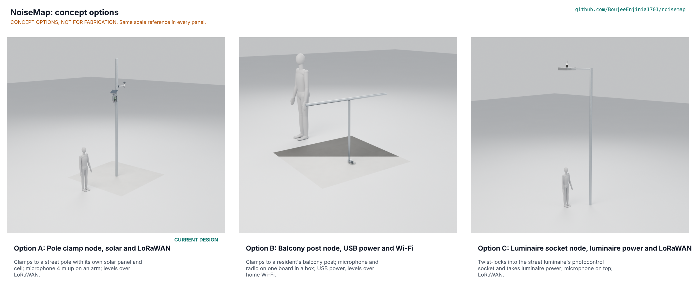

# NoiseMap concept options

Proposed, awaiting Amish: A and B score within 10 % of each other (A 171, B 163, a gap of 4.7 %), so under STANDARDS section 21 both go to Amish without a pick; C scores 11.1 % below A. The current design, option A, stays the design of record and is not changed. Method: STANDARDS section 21.

*Figure 1. The three options modelled at D3 from `cad/src/model.py` and drawn at one scale with a 1.75 m person (`python .kit/options.py`). The picture is rendered by the coordinator; it shows the same geometry that `cad/fidelity.json` checks. CONCEPT, NOT FOR FABRICATION.*

## The options

### Option A: Pole clamp node, solar and LoRaWAN (the current design)

**Working principle:** a MEMS microphone in a printed head 4.0 m up a street pole turns sound into A- and C-weighted levels on the spot; a standard FieldNode core with its own solar panel and cell sends a 22-byte record every 15 minutes over LoRaWAN. Described in full in NSM-PRC-001 and calculated in NSM-CAL-001: 12.2 mW, 53 days without sun, 34.9 to 113 dBA, 3.45 kg. Modelled with 89 parts (46 of them screws, bolts and nuts), mass 3.5 kg. Key risks: accuracy, range and frequency response at risk (PR-003 to PR-005); a thin 0.05 kg mass margin; work at height. Needs from a co-design partner: a pole owner, a class 1 reference meter beside the node, and a LoRaWAN gateway.

### Option B: Balcony post node, USB power and Wi-Fi

**Working principle:** the microphone, level processor and Wi-Fi radio are one board in an IP65 box clamped by two bands to a resident's balcony post; a USB supply powers it and levels go over the home Wi-Fi to an open server. No solar panel, cell, pole or LoRaWAN. A short printed duct carries sound from the lid port to the microphone on the board. It is the Sensor.Community DNMS idea (NSM-PRB-001, Prior work) with levels computed on board and a clamp instead of a window mount. Modelled with 28 parts (12 fasteners), mass 1.0 kg. Key risks: the microphone sits within about a metre of a facade, so reflection bias is larger than on a pole; the 38 mm duct is a quarter-wave resonator near 2.2 kHz (estimate), so the frequency response needs a shorter or damped duct; a 1 kg box can fall from a balcony; microphone and radio share one board, which weakens the physical separation behind the privacy claim. Needs from a co-design partner: a resident host and a place to run the server.

### Option C: Luminaire socket node, luminaire power and LoRaWAN

**Working principle:** a puck twist-locks into the street luminaire's photocontrol receptacle (ANSI C136.41 class, Zhaga Book 18 context; applicability to assess, NSM-REG-001 G11) and takes power from the luminaire through an isolated converter; the microphone sits on top about 6 m up and a LoRa module sends the record. No solar panel, cell or clamp. Modelled with 24 parts (8 fasteners), mass 0.2 kg. Key risks: mains voltage inside the puck (safety standards and certification to assess); some lighting circuits are switched off by day; work at height at a live luminaire by a trained electrician; heat from the luminaire; the NoiseMap constraint of no electrical connection to the pole is not met. Needs from a co-design partner: a lighting operator who allows a node on its luminaires and an electrician.

## First-order numbers

Table 1. Options compared. Part counts and mass come from `cad/fidelity.json` (volumes times material density, so they include everything modelled); costs for B and C are the author's estimates from typical module and enclosure classes, uncited and to confirm with supplier quotes; A's cost is the priced BOM.

| Quantity | Option A | Option B | Option C |
| --- | --- | --- | --- |
| Estimated parts cost (USD) | 72.00 NoiseMap parts, 211.00 full node (priced BOM) | about 38 (estimate) | about 47 (estimate; certification not included) |
| Mass (kg) | 3.5 | 1.0 | 0.2 |
| Output or throughput | 22 byte record every 15 min, LoRaWAN | levels each second possible over Wi-Fi (record format to define) | 22 byte record every 15 min, LoRaWAN |
| Energy or effort | 12.2 mW from its own cell, solar harvest 5.81 Wh/day | about 0.6 W from USB, about 5 kWh a year (STM S20) | about 0.7 W from the luminaire, about 6 kWh a year (STM S23) |
| Parts count (model) | 89 | 28 | 24 |
| STEM check | S1 to S19 pass; 3 plausible, closed by NSM-CAL-001 | S20 to S22 pass | S23 and S24 pass; isolation is a certification question (NSM-REG-001 G12) |
| Detail level | D3, 89 parts, no overlaps | D3, no overlaps | D3, no overlaps |

## Scoring

Table 2. Weighted scoring (weights: High UR 3, Medium 2, Low 1; scores 1 to 5, 5 best). The user requirements are those of NSM-URS-001; the last four rows are the criteria of STANDARDS section 21. Scores are the author's proposals, "Proposed, awaiting Amish".

| Criterion | Source | Weight | A | B | C | Reason |
| --- | --- | --- | --- | --- | --- | --- |
| UR-001 No eavesdropping | UR-001 | 3 | 4 | 2 | 3 | A: processing in the head, no radio or storage there, slow cable. B: microphone, processor and Wi-Fi radio on one board with a fast link to the internet. C: one board carries microphone and LoRa radio, but the radio is slow. |
| UR-002 Night-time evidence | UR-002 | 3 | 4 | 3 | 4 | A and C measure at street height; B measures at one resident's balcony, which is the resident's own need but not the street. |
| UR-003 Credible accuracy | UR-003 | 3 | 3 | 2 | 3 | B sits within a metre of a facade and a railing, so reflection bias can reach several dB; A and C are clear of facades, with a site correction (NSM-CAL-001 C2). |
| UR-004 Quiet to loud | UR-004 | 3 | 3 | 3 | 3 | Same microphone and gain in all three; A's range is at risk (PR-004); the IM72D128 is fitted by default. |
| UR-005 Bass from venues | UR-005 | 2 | 3 | 2 | 3 | B's 38 mm acoustic duct is a quarter-wave resonator near 2.2 kHz (estimate); A and C keep the 3 mm port and 0.5 mm cavity of NSM-CAL-001 B3. |
| UR-006 Events can be dated | UR-006 | 2 | 4 | 4 | 4 | LoRaWAN network time (A, C) or NTP over Wi-Fi (B). |
| UR-007 No power at the pole | UR-007 | 3 | 5 | 2 | 3 | A is energy neutral on its own panel; B needs a USB supply from the home; C needs the luminaire circuit to be live, and some circuits are switched off by day. |
| UR-008 Clamp on, nothing drilled | UR-008 | 3 | 4 | 4 | 2 | C needs a lift or bucket truck at 6 m and a trained person at a live luminaire. |
| UR-009 Light and wind-proof | UR-009 | 3 | 3 | 3 | 4 | A adds about 96 N and 3.45 kg at 4 m (lanyard fitted); B's 1 kg box could fall from a balcony onto the street; C is 0.16 kg and twist-locked. |
| UR-010 Outdoors for years | UR-010 | 2 | 3 | 3 | 2 | C sits on a hot luminaire housing, which accelerates ageing of the printed housing and seals. |
| UR-011 Know which data are spoiled | UR-011 | 2 | 3 | 3 | 3 | Same level-based wind flag in all three. |
| UR-012 Quick field check | UR-012 | 2 | 3 | 5 | 2 | B is reached by hand; A at 4 m by pole or ladder; C at 6 m. |
| UR-013 Shares the airwaves fairly | UR-013 | 2 | 4 | 4 | 4 | LoRa fair use (A, C) or licence-free Wi-Fi (B). |
| UR-014 Cheap enough for many streets | UR-014 | 3 | 3 | 5 | 4 | Full node about USD 211 (A), about USD 38 (B), about USD 47 (C), author's estimates for B and C. |
| UR-015 Open and checkable | UR-015 | 3 | 4 | 4 | 3 | C's mains converter and isolation need a certified part, which narrows what can be fully open. |
| UR-016 Public notice | UR-016 | 2 | 4 | 2 | 3 | A notice plate on a street pole is natural; on a private balcony it is less so. |
| Cost against the value-engineering target | budget_usd | 2 | 3 | 5 | 4 | A: NoiseMap parts USD 72 against USD 100, full node USD 211. B and C are estimates and lower. |
| Buildable with local skills and tools | STANDARDS 21 | 2 | 3 | 5 | 3 | A needs sawing, bending, printing and soldering; B is a box and a board; C needs mains-rated design and certified parts. |
| Safety | STANDARDS 21 | 3 | 3 | 3 | 2 | A: work at height and a lithium cell. B: falling object and a mains adapter. C: mains voltage inside, work at height at a live luminaire. |
| Maintenance | STANDARDS 21 | 1 | 3 | 4 | 3 | A changes foam yearly and a cell once; B is within reach; C needs a lift for any visit. |
| **Weighted total (maximum 245)** | | 49 | **171** | **163** | **152** | A 69.8 %, B 66.5 %, C 62.0 % of the maximum |

## Recommendation

Proposed, awaiting Amish. Option A scores 171 against B's 163 and C's 152. A and B are within 10 % (4.7 %), so this document does not pick between them. It records what each does best:

- **A** wins on the requirements that define the NoiseMap pitch: street-level evidence, no mains power, nothing drilled, and levels-only privacy with the radio kept apart from the microphone head.
- **B** wins on cost, buildability, ease of field check and reach; it serves a different user (a resident who wants evidence at their own window) and could be offered as a low-cost companion node rather than a replacement.
- **C** scores lowest because of mains voltage, work at height and the loss of the no-electrical-connection constraint.

Until Amish decides, option A remains the design of record (`concept_chosen: "A (proposed)"` in `project.yaml`), the drawing, priced BOM and build plan describe A only, and nothing is redesigned. Best idea of the runner-up to graft onto A, if A is carried forward: B's single board carrying microphone, processor and radio is the saving already listed in NSM-DEC-001 (head and microphone on one board once the head design settles); B's hand-reachable calibration check suggests a calibrator port that opens at the foot of the head so the check can be done from the arm's reach. Neither is made in this session.

The decision is argued in NSM-DDR-004 and listed in the design decisions register.
